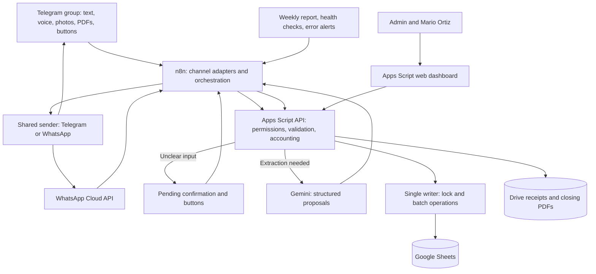
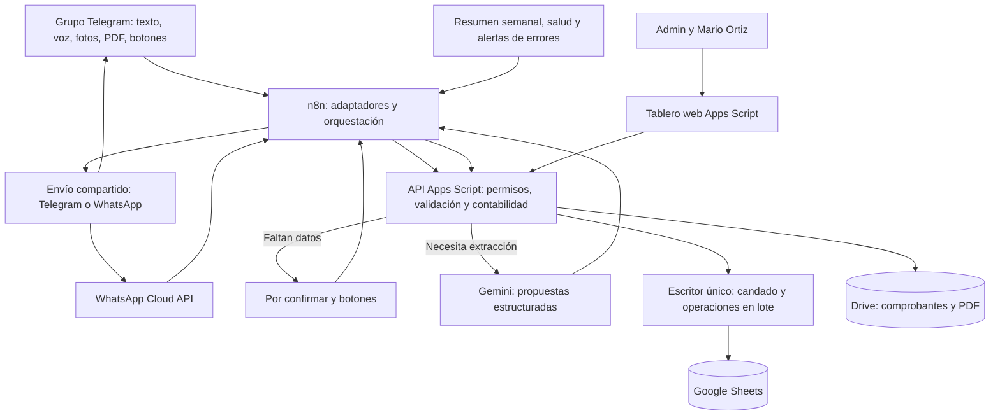

# Chat-based fleet accounting

**From scattered chat messages and Excel reconciliation to a shared operational ledger.**

William Delgado — Industrial automation & AI agents

[English](#english) · [Español](#español)

## English

### The problem

A small trucking operation in Colombia manages three vehicles: **TRK101, TRK202 and VAN303**. Expenses, refuels, trips, loading, freight collections and fertilizer sales arrive throughout the day from several people. Reconciling the driver's account in Excel meant collecting messages and receipts, interpreting who paid, copying figures, and checking customer debts manually.

This project turns those messages into traceable records. **Telegram and WhatsApp share one accounting core**, with a Google Apps Script dashboard for two administrators and Google Sheets as the operational ledger. The central rule: **the AI proposes; deterministic code decides**.

### Architecture



The six importable workflows are inactive templates. See [architecture](docs/architecture.md) for the export inventory and implementation details.

### Key features

- **Group chat capture:** authorized people record activity using ordinary Spanish messages. WhatsApp messages and bot responses are copied to the administrative Telegram group.
- **Voice and documents:** extract structured proposals from voice notes, receipt photos and PDFs, then apply business validation. The bundled voice nodes use Gemini; Groq Whisper belongs to the earlier reference design.
- **Buttons for ambiguity:** persist the question context and ask for missing or ambiguous money, vehicle or payer information. Confirmation locks protect against repeated taps.
- **Duplicate prevention:** Telegram `update_id`, WhatsApp message-derived IDs, form keys and callback locks protect the write path.
- **One ledger:** batch reads, one snapshot per locked write pass, batch writes resolved by record ID, and one Apps Script writer shared by chat and dashboard. The one-read design target and probe/reread exceptions are documented in the architecture guide.
- **Operational control:** driver's running balance, vehicle costs and fuel efficiency, maintenance reminders, freight, fertilizer inventory, customer debts and partial payments.
- **Period closing:** generate a statement PDF, freeze the period, carry the balance forward and track delivery for retry.
- **Oversight:** an admin dashboard, Sunday summary, health checks and error alerts. WhatsApp weekly notices wait for an open messaging window when needed.

### How people use it

| Role | Daily work |
|---|---|
| Diego, driver with an account | Sends expenses, refuels, trips and loading; answers buttons; checks his balance; replies to a bot record to request a correction or void. |
| Admin and Mario Ortiz | Review missing prices and receipts, debts, costs and fuel efficiency; maintain catalogs; correct records; generate PDFs and close periods. |
| Registrars | Record authorized vehicle activity without a driver wage account of their own. Permissions and payer defaults come from the user catalog. |

Diego has read-only account access through chat queries and shared statements. A separate keyed driver web view was planned, then deferred; the supplied web dashboard is administrative. [Daily operations](docs/daily-operations.md).

### Faster, cleaner information management

Recording an event when it happens removes a later transcription step. Receipts stay linked to records; payer and vehicle fields separate company cost from money owed to the driver. Customer collections are counted at their source instead of copied into a second ledger. Administrators inspect missing information and totals without reconstructing chat history, while corrections preserve an audit trail. This public copy makes no measured time-saving claim.

### Engineering with agents

The project used an **Architect → Sculptor → independent Auditor** method: classify risk, delegate a bounded task, execute offline checks, and return required fixes through at most two audit cycles. The documented Claude Code setup used Sonnet for lighter work and Opus for complex implementation and review. Later sessions also used separate Codex execution and audit threads. Human approval gates covered production, money-sensitive changes and destructive operations. [Method and lessons](docs/agent-methodology.md).

### Repository structure

```text
workflows/                  Six inactive n8n workflow exports
apps-script/dashboard/      Accounting core, admin UI, PDF tools and five Node test suites
docs/                       Architecture, business rules, data model and operating guide
.claude/agents/             Example implementer and read-only auditor roles
.claude/rules/              Workflow compatibility rules
.claude/skills/             Offline workflow checks and delivery audit
AGENTS.md / CLAUDE.md        Reusable collaboration instructions
```

### Tech stack

Self-hosted **n8n** (export target: 2.41.6), Telegram Bot API, WhatsApp Cloud API, JavaScript / Google Apps Script, Google Sheets API v4, Google Drive, Gemini Flash Lite, HTML/CSS, Chart.js, Node.js tests and Python workflow inspection scripts. Model names reflect snapshot configuration, not a promise of present availability or free quota.

### Adapt and install

1. Run the offline checks below. Read [business rules](docs/business-rules.md), [data model](docs/data-model.md) and [dashboard setup](apps-script/dashboard/README.md).
2. Create a native Google Sheet and bound Apps Script project in a separate test environment. Add the supplied files and manifest, enable Sheets v4, and run `instalarHoja`. Populate fictitious catalogs first; `sembrarDatosPrueba` requires a file name containing `PRUEBA`.
3. Configure script properties and channel credentials privately. Configure administrator authorization and user/payer mappings. Keep secrets out of source files and exports.
4. Deploy the API and admin dashboard with the access settings in the setup guide. Replace every workflow, table, endpoint, account and credential placeholder; review references and error-workflow assignments after import.
5. Import all workflows **inactive**. Configure the shared sender and WhatsApp state tables before testing the bot and inbound adapter; configure weekly and monitoring workflows afterwards. [WhatsApp dependencies](docs/whatsapp-integration.md).
6. Exercise valid, invalid, duplicate, busy-lock, correction, void and period-close paths in the test environment. Compare chat and dashboard balances. For a replacement on the same Telegram bot, **unpublish the old workflow before publishing the new one**.

Run from `apps-script/dashboard`:

```sh
node test.js
node test-tablero.js
node test-pdf.js
node test-copia.js
node test-pdf-lib.js
```

See [workflow checking instructions](.claude/skills/n8n-workflow-check/SKILL.md) and the [validation report](docs/validation-report.md). Offline mocks cannot validate live permissions, provider behavior, Google conversion or actual locks.

### Language and privacy

Documentation and development instructions are in English. **Runtime messages, the dashboard interface, identifiers, node names, sheet tabs and headers remain Spanish** for the people using the system. [Glossary](docs/glossary.md).

All names, plates, IDs and phone numbers in the showcase are fictitious or placeholders, except the credited author. Example and fixture amounts are illustrative, not operating balances. Configure your own private deployment. Licensed under [MIT](LICENSE).

## Español

### El problema

Una pequeña operación de transporte en Colombia maneja tres vehículos: **TRK101, TRK202 y VAN303**. Varias personas reportan durante el día gastos, tanqueos, viajes, cargues, fletes y ventas de abono. Cuadrar la cuenta del conductor en Excel exigía reunir mensajes y comprobantes, interpretar quién pagó, copiar valores y revisar las deudas de clientes a mano.

Este proyecto convierte esos mensajes en registros trazables. **Telegram y WhatsApp comparten un solo núcleo contable**, con un tablero de Google Apps Script para dos administradores y Google Sheets como registro operativo. La regla central: **la IA propone; el código determinista decide**.

### Arquitectura



Los seis flujos importables son plantillas inactivas. [Arquitectura](docs/architecture.md) detalla su inventario e implementación.

### Funciones principales

- **Registro en el grupo:** personas autorizadas reportan en español. Los mensajes de WhatsApp y las respuestas del bot se copian al grupo administrativo de Telegram.
- **Voz y documentos:** notas de voz, fotos y PDF producen propuestas estructuradas que valida el código. Los nodos de voz incluidos usan Gemini; Groq Whisper pertenece al diseño de referencia anterior.
- **Botones ante ambigüedades:** se guarda el contexto y se pregunta por dinero, placa o pagador faltantes. Los candados protegen contra toques repetidos.
- **Sin duplicados:** `update_id` de Telegram, IDs derivados del mensaje WhatsApp, claves de formulario y candados protegen las escrituras.
- **Una sola cuenta:** lecturas en lote, una instantánea por pasada de escritura con candado, escrituras por ID y un único escritor Apps Script para bot y tablero. La arquitectura explica la meta de una lectura y las excepciones de sondeo y relectura.
- **Control operativo:** saldo de Diego, costos por vehículo, combustible, mantenimiento, fletes, inventario de abono, deudas y pagos parciales.
- **Cortes:** PDF del estado de cuenta, congelación del periodo, traslado del saldo y seguimiento de entregas para reintentar.
- **Supervisión:** tablero administrativo, resumen del domingo, salud y alertas de errores. Los avisos por WhatsApp esperan una ventana de mensajería abierta si hace falta.

### Uso diario por persona

| Rol | Trabajo cotidiano |
|---|---|
| Diego, conductor con cuenta | Registra gastos, tanqueos, viajes y cargues; responde botones; consulta saldo; responde al bot para pedir corrección o anulación. |
| Admin y Mario Ortiz | Revisan precios y soportes faltantes, deudas, costos y rendimiento; mantienen catálogos; corrigen; generan PDF y cierran cortes. |
| Registradores | Reportan actividad autorizada de vehículos sin una cuenta de sueldo propia. El catálogo define sus permisos y pagador predeterminado. |

Diego consulta su cuenta en modo lectura por chat y mediante estados compartidos. La vista web propia con clave se planeó y luego se aplazó; el tablero incluido es administrativo. [Operación diaria](docs/daily-operations.md).

### Información más rápida y ordenada

Registrar en el momento elimina una transcripción posterior. Los comprobantes quedan unidos al registro; pagador y placa separan el costo del vehículo de lo que se le debe al conductor. Los cobros se cuentan desde su origen, sin copiarlos a otro libro. Los administradores revisan faltantes y totales sin reconstruir el chat; las correcciones dejan rastro. Esta copia pública no afirma un ahorro de tiempo medido.

### Trabajo con agentes

Se usó **Arquitecto → Escultor → Auditor independiente**: clasificar el riesgo, delegar una tarea acotada, ejecutar verificaciones locales y devolver correcciones durante un máximo de dos ciclos. La configuración documentada de Claude Code usó Sonnet para tareas ligeras y Opus para las complejas; después también se usaron hilos separados de ejecución y auditoría en Codex. Producción, cambios sensibles de dinero y acciones destructivas tenían aprobación humana. [Método y lecciones](docs/agent-methodology.md).

### Estructura del repositorio

```text
workflows/                  Seis exportaciones n8n inactivas
apps-script/dashboard/      Núcleo contable, tablero, PDF y cinco suites Node
docs/                       Arquitectura, negocio, datos y operación
.claude/agents/             Ejemplos de ejecutores y auditores de solo lectura
.claude/rules/              Reglas de compatibilidad de flujos
.claude/skills/             Verificación local y auditoría de entrega
AGENTS.md / CLAUDE.md        Instrucciones reutilizables de colaboración
```

### Tecnologías

**n8n** autohospedado (exportación para 2.41.6), Telegram Bot API, WhatsApp Cloud API, JavaScript / Google Apps Script, Google Sheets API v4, Drive, Gemini Flash Lite, HTML/CSS, Chart.js, pruebas Node.js y scripts Python. Los modelos reflejan la configuración exportada; su disponibilidad y cuota gratuita deben revisarse al adaptar el sistema.

### Adaptación e instalación

1. Ejecute las verificaciones locales. Lea [reglas de negocio](docs/business-rules.md), [modelo de datos](docs/data-model.md) e [instalación del tablero](apps-script/dashboard/README.md).
2. Cree una hoja nativa y un proyecto Apps Script ligado en un entorno de pruebas separado. Agregue archivos y manifiesto, active Sheets v4 y ejecute `instalarHoja`. Use catálogos ficticios; `sembrarDatosPrueba` exige un nombre con `PRUEBA`.
3. Configure propiedades y credenciales de forma privada. Defina administradores, usuarios y pagadores; mantenga los secretos fuera del código y las exportaciones.
4. Implemente API y tablero con los accesos de la guía. Sustituya todos los marcadores de flujos, tablas, URL, cuentas y credenciales. Revise referencias y flujo de errores al importar.
5. Importe los flujos **inactivos**. Configure primero envío y tablas WhatsApp, después bot y entrada; termine con resumen y monitoreo. [Dependencias WhatsApp](docs/whatsapp-integration.md).
6. Pruebe casos válidos, inválidos, duplicados, candado ocupado, corrección, anulación y cierre. Compare saldo del bot y tablero. Para reemplazar un flujo con el mismo bot Telegram, **despublique el viejo antes de publicar el nuevo**.

Desde `apps-script/dashboard`:

```sh
node test.js
node test-tablero.js
node test-pdf.js
node test-copia.js
node test-pdf-lib.js
```

Consulte [n8n-workflow-check](.claude/skills/n8n-workflow-check/SKILL.md) y el [informe de validación](docs/validation-report.md). Los mocks no prueban permisos reales, proveedores, conversiones de Sheets ni candados reales.

### Idioma y privacidad

La documentación técnica y las instrucciones de desarrollo están en inglés. **Mensajes, interfaz, identificadores, nombres de nodos, pestañas y encabezados permanecen en español** porque así trabajan los usuarios. [Glosario](docs/glossary.md).

Los nombres, placas, IDs y teléfonos son ficticios o marcadores, salvo el autor acreditado. Los valores de ejemplos y pruebas son ilustrativos, no saldos operativos. Cada instalación requiere configuración privada. Licencia [MIT](LICENSE).
